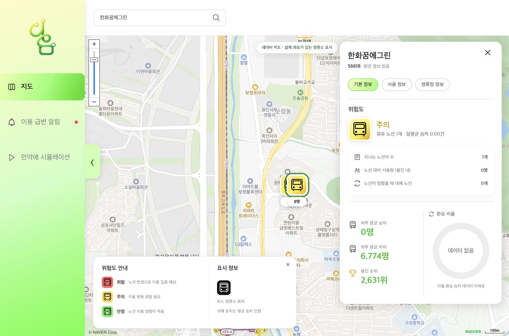
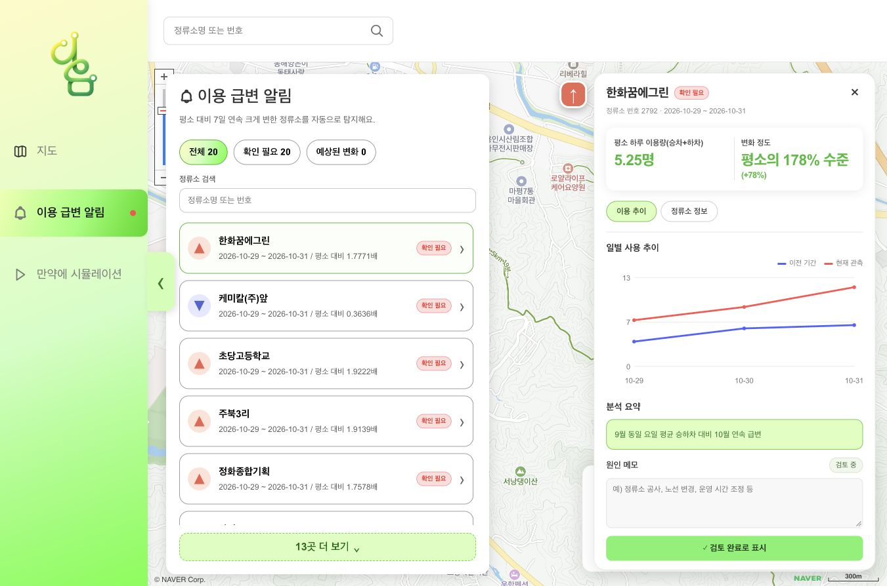
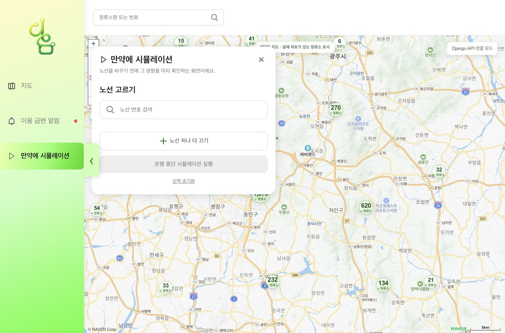
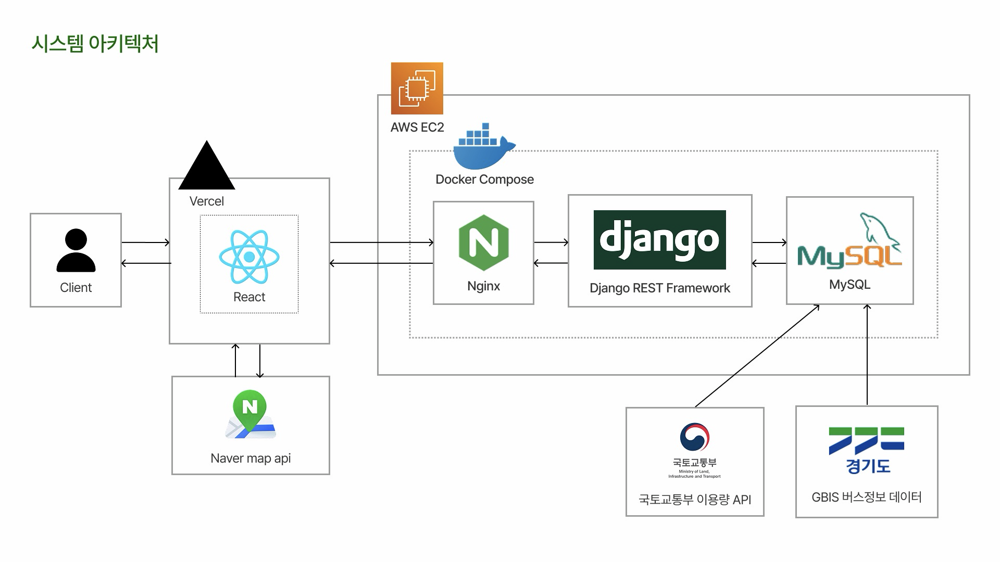

# 이음 | 용인시 대중교통 분석 백엔드

**이음**은 용인시 버스 정류소의 이용 변화를 파악하고, 노선 운행이 중단될 때 어떤 정류소가 영향을 받는지 미리 살펴보는 서비스입니다. 공개 승하차 데이터와 노선망 정보를 바탕으로 정류소별 위험도를 지도에 표시하고, 평소와 이용 패턴이 달라진 정류소를 알림으로 보여줍니다.

백엔드는 정류소·노선 데이터와 분석 결과를 API로 제공하고, 알림 검토 이력 저장과 노선 운행 중단 시뮬레이션, PDF 보고서 생성을 담당합니다.

[배포 사이트에서 체험하기](https://ieum-fe.vercel.app/)



## 데모 사용법

### 1. 지도에서 정류소 위험도 확인하기

1. 사이드바에서 **지도**를 선택합니다.
2. 정류소 이름이나 번호를 검색합니다. 예를 들어 `한화꿈에그린`을 검색할 수 있습니다.
3. 검색 결과에서 정류소를 선택하고 **기본 정보**에서 위험도, 경유 노선 수, 일평균 승하차를 확인합니다.
4. **사용 정보**에서 이용 추이를, **정류장 정보**에서 정류소 상세 정보를 살펴봅니다.

지도는 정류소의 위험도를 **위험·주의·안정**으로 표시합니다. 마커 아래 숫자는 평균 승차 인원입니다. 같은 이름의 정류소가 여러 곳이면 정류소 번호로 구분할 수 있습니다.

### 2. 이용 급변 알림 확인하고 검토하기

1. 사이드바에서 **이용 급변 알림**을 선택합니다.
2. 정류소를 검색하거나 **확인 필요**, **예상된 변화** 필터로 알림을 좁힙니다.
3. 알림을 열고 변화 기간, 평소 대비 변화 정도, 일별 이용 추이를 확인합니다.
4. 원인을 확인했다면 **원인 메모**를 입력하고 **검토 완료로 표시**를 선택합니다. 검토 결과는 해당 알림에 저장됩니다.



### 3. 노선 운행 중단 영향 비교하기

1. 사이드바에서 **만약에 시뮬레이션**을 선택합니다.
2. `10`과 같이 노선 번호를 검색해 중단을 가정할 노선을 선택합니다. 여러 노선을 함께 검토하려면 **노선 하나 더 끄기**를 선택합니다.
3. **운행 중단 시뮬레이션 실행**을 누르고, 위험도가 바뀌는 정류소와 일평균 추정 영향을 확인합니다.
4. **결과 저장(PDF)**을 선택하면 분석 결과를 보고서로 저장할 수 있습니다.



## 시스템 아키텍처



| 구성 | 역할 |
| --- | --- |
| **프론트엔드 · Vercel** | 지도, 정류소 상세, 알림 검토, 시뮬레이션 화면 제공 |
| **Nginx · Gunicorn** | 운영 환경의 웹 요청 수신 및 Django 연결 |
| **Python · Django REST Framework** | 정류소·노선 조회, 알림 검토 저장, 시뮬레이션 실행 및 PDF 응답 |
| **MySQL** | 정류소와 노선망, 승하차 데이터, 분석 결과 및 검토 이력 저장 |
| **Docker Compose** | 로컬 개발 환경과 운영 환경의 서비스 구성 관리 |

## 데이터와 분석 흐름

1. **기초 데이터 적재** — 정류소 위치, 노선별 경유 정보, 일별 승차·하차 데이터를 저장합니다. STCIS 이용량 배치의 누락값과 일부 0 대체값은 국토부 승하차 API로 보완할 수 있습니다.
2. **정류소 진단과 급변 탐지** — 경유 노선과 이용량을 바탕으로 정류소 위험도를 계산하고, 이용량이 평소와 크게 달라진 경우 급변 알림을 생성합니다.
3. **분석 결과 제공** — 최신 완료 분석을 기준으로 진단 결과와 급변 알림을 제공하고, 알림에 대한 검토 결과를 저장합니다.
4. **운행 중단 영향 계산** — 선택한 노선의 운행이 중단된 상황을 가정해 정류소별 위험도 변화를 계산합니다. 완료된 결과는 화면에서 조회하거나 PDF로 내려받을 수 있습니다.

## 주요 API

| 기능 | 메서드 및 경로 | 설명 |
| --- | --- | --- |
| 정류소 검색 | `GET /api/stations/` | 정류소명·번호 검색 및 목록 조회 |
| 정류소 지도 | `GET /api/stations/map/` | 지도에 표시할 좌표와 위험도 조회 |
| 정류소 상세 | `GET /api/stations/{id}/` | 정류소 기본 정보와 위험도 조회 |
| 정류소 이용량 | `GET /api/stations/{id}/usage/` | 승하차 등 정류소 이용 정보 조회 |
| 정류장 정보 | `GET /api/stations/{id}/details/` | 정류장 정보 탭에 표시할 상세 정보 조회 |
| 급변 알림 | `GET /api/alerts/` | 이용 급변 알림 목록과 건수 조회 |
| 알림 상세 | `GET /api/alerts/{id}/` | 급변 요약, 일별 이용 추이, 최근 검토 결과 조회 |
| 알림 검토 | `POST /api/alerts/{id}/reviews/` | 원인 메모와 검토 결과 등록 |
| 노선 조회 | `GET /api/routes/`, `GET /api/routes/{id}/` | 노선 목록과 상세 정보 조회 |
| 시뮬레이션 실행 | `POST /api/simulations/` | 선택한 노선의 운행 중단 영향 분석 |
| 시뮬레이션 결과 | `GET /api/simulations/{id}/`, `GET /api/simulations/{id}/stops/` | 결과 요약과 정류소별 영향 조회 |
| PDF 보고서 | `GET /api/simulations/{id}/export/` | 완료된 시뮬레이션 보고서 다운로드 |

## 로컬에서 실행하기

Docker와 Docker Compose가 설치된 환경에서 저장소 루트로 이동합니다.

```bash
cp .env.example .env
```

`.env`에 `DJANGO_SECRET_KEY`, `DB_NAME`, `DB_USER`, `DB_PASSWORD`, `MYSQL_ROOT_PASSWORD`를 설정합니다.

```bash
docker compose up -d --build
docker compose exec web python src/manage.py migrate
curl --fail 'http://localhost:8000/api/stations/?page=1&page_size=5'
```

호스트에서 3306 포트를 이미 사용 중이면 `.env`의 `DB_PORT`를 3307 같은 빈 포트로 바꿉니다. Django 컨테이너는 내부 주소 `db:3306`으로 접속합니다.

새 MySQL 볼륨을 처음 시작하면 [`db/schema.sql`](db/schema.sql)에 정의된 서비스 테이블이 생성됩니다. 배포 화면과 동일한 결과를 보려면 정류소·노선망, 승하차 데이터와 완료된 분석 결과가 필요합니다.

### 기존 MySQL 볼륨 사용하기

기존 볼륨에서 서비스 테이블이 아직 하나도 없다면 다음 명령으로 스키마를 적용할 수 있습니다.

```bash
docker compose exec -T db sh -c 'MYSQL_PWD="$MYSQL_PASSWORD" mysql --default-character-set=utf8mb4 -u "$MYSQL_USER" "$MYSQL_DATABASE"' < db/schema.sql
```

기존 테이블에 내부 ID 자동 증가 변경을 아직 적용하지 않았다면 아래 SQL을 실행해 정류소와 노선의 내부 ID에 자동 증가를 적용합니다.

```bash
docker compose exec -T db sh -c 'MYSQL_PWD="$MYSQL_PASSWORD" mysql --default-character-set=utf8mb4 -u "$MYSQL_USER" "$MYSQL_DATABASE"' < db/updates/001_auto_increment_transit_ids.sql
```

## 국토부 승하차 이용량 배치와 AI 분석

서버 실행 환경에 `STOP_BY_ROUTE_TRIP_VOLUME_SERVICE_KEY`를 주입한 뒤 실행합니다.

```bash
python src/manage.py import_station_usage \
  --from 2026-10-04 --to 2026-10-31 \
  --batch-id NEW_BATCH_ID --fallback-batch-id STCIS_BATCH_ID \
  --fallback-csv /path/to/stop_daily_usage_ready.csv \
  --ai-dir /path/to/AI --ai-python /path/to/AI/.venv/bin/python \
  --network-dir /path/to/network-csv --network-id NETWORK_ID
```

배치 ID와 노선망 ID는 실제 숫자로 바꿉니다. 대체 배치는 READY 상태인 STCIS
승하차 배치이며, 적재에 사용한 원본 CSV로 0 대체 행을 식별합니다.
기존 관측 행은 유지합니다. 0 대체 행과 미확보 정류장은 API에서 ARS 번호와
정류장명으로 대조합니다. API에서 확인된 수치를 저장하고, 확인하지 못한 대체값은
기존 0을 유지합니다. 한 구에서 페이지 조회가 실패해도 다른 구의 결과는 사용합니다.
날짜별로 원본 CSV 대상 정류장의 95%를 확보해야 저장합니다. 필요하면
`--min-coverage`로 기준을 설정할 수 있습니다. STCIS 행이 없는 날짜는 세 구의
API 페이지 조회가 모두 완료되어야 합니다.

미확보 검토 CSV를 `--missing-csv /path/to/stop_daily_usage_review.csv`로 지정하면
해당 CSV의 미확보 날짜·정류장만 보완하고 기존 0 대체값도 그대로 유지합니다.

AI 저장소, 실행 환경, 모델 및 노선 CSV는 실행 환경에서 접근 가능해야 합니다.
AI 분석에는 대체 배치에서 확보할 수 있는 직전 91일의 이력도 전달합니다.
`--history-days`로 이력 범위를 조정할 수 있습니다. 분석 결과가 모두 저장된 후에
완료 분석으로 전환되며, 이용량·지도·알림·시뮬레이션의 기준이 새 분석으로 갱신됩니다.
AI 관련 세 옵션을 생략하면 이용량 배치만 저장합니다.

## 데이터 범위와 피드백

정류소별로 조회할 수 있는 항목은 원천 데이터의 제공 범위에 따라 달라집니다. 예를 들어 배포 화면에서 10월 환승 승차 데이터는 미제공으로 표시됩니다. 시뮬레이션 결과는 선택한 노선의 운행 중단을 가정한 추정치입니다.

오류나 기능 제안은 아래 항목과 함께 남겨 주세요. 데이터가 이상해 보인다면 화면에 표시된 날짜나 기간도 함께 적어 주세요. [BE GitHub Issues](https://github.com/ieum-yongin/BE/issues)

- **어느 화면에서** — 지도, 이용 급변 알림, 만약에 시뮬레이션
- **어떤 항목에서** — 정류소명·번호, 노선 번호 또는 해당 알림
- **어떤 순서로** — 문제가 발생하기까지 클릭하거나 입력한 내용
- **어떻게 보였는지** — 기대한 결과, 실제 결과, 가능하면 화면 캡처
